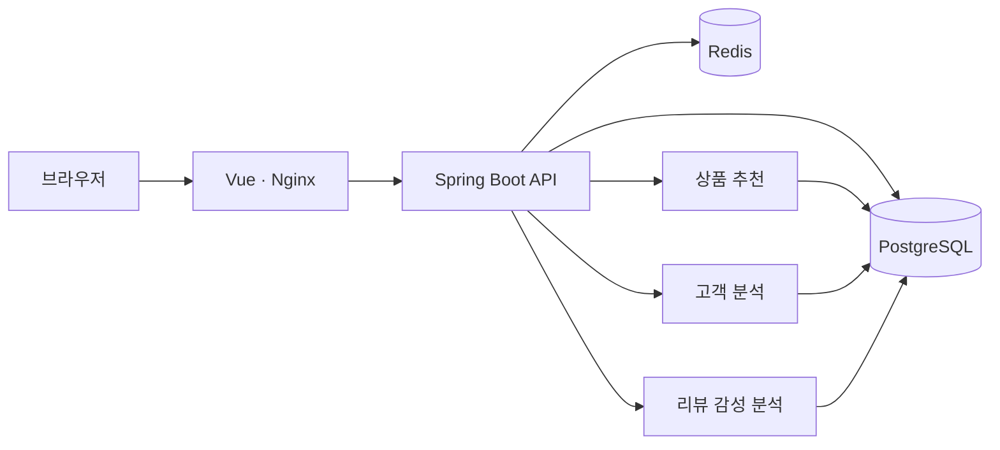

# GT전자 쇼핑몰 · GTEC

PC 부품과 주변기기를 판매하는 쇼핑몰과 운영자 대시보드를 통합한 프로젝트입니다. 구매자는 상품 탐색부터 결제와 주문 조회까지 이용하고, 운영자는 상품·주문·배송을 관리하면서 추천과 고객·리뷰 분석 결과를 확인할 수 있습니다.

## 주요 기능

- **쇼핑몰** — 상품 카탈로그와 상세 이미지, 장바구니 및 부품 호환성 안내, 찜, 주문·배송 조회, 리뷰와 고객센터
- **인증·결제** — 일반 회원과 관리자 권한 분리, Google·카카오·네이버 OAuth 로그인, 토스페이먼츠 결제 연동
- **운영자 대시보드** — 상품·주문·배송·반품 관리, 공지와 FAQ 관리, 고객 분석 및 리뷰 감성 현황
- **AI 서비스** — 구매 이력 기반 상품 추천과 부품 호환성 검사, 고객 구매 패턴 분석, 한국어 리뷰 감성 분류

## 구조와 기술 스택

| 경로 | 구성 | 기술 |
| --- | --- | --- |
| [`frontend/`](frontend/) | 쇼핑몰과 운영자 대시보드 | Vue 3, Vite, Pinia, Chart.js, Nginx |
| [`backend/`](backend/) | 쇼핑몰 REST API, 인증, 결제, AI 게이트웨이 | Java 21, Spring Boot, Spring Security, JPA, Gradle |
| [`backend/ai-services/`](backend/ai-services/) | 추천, 고객 분석, 리뷰 분석 | Python 3.12, FastAPI, scikit-learn, PyTorch, Transformers |
| [`compose.yaml`](compose.yaml) | 웹·API·AI 서비스와 데이터 저장소 | Docker Compose, PostgreSQL 18, Redis 7 |



## 로컬 실행

세 기능 브랜치와 루트 설정이 통합된 `main`에서 실행합니다. Docker Desktop 또는 Docker Engine과 Compose, Git LFS가 필요합니다.

1. 저장소를 클론한 뒤 모델 파일을 내려받습니다. 소스 ZIP에서는 모델이 LFS 포인터로 들어 있을 수 있습니다.

   ```bash
   git clone https://github.com/moonjunghun13-cmyk/project_GTEC.git
   cd project_GTEC
   git lfs install
   git lfs pull
   ```

2. 루트에 `.env.docker.local`을 만들고 아래 값을 설정합니다. 결제 검증에는 토스페이먼츠 테스트 키를 사용하세요. OAuth를 검증하려면 각 제공자 콘솔에도 콜백 주소를 등록해야 합니다.

   | 변수 | 용도 |
   | --- | --- |
   | `USER_NAME`, `PASSWORD` | PostgreSQL 계정 |
   | `JWT_SECRET` | 백엔드 JWT 서명 |
   | `GOOGLE_CLIENT_ID`, `GOOGLE_CLIENT_SECRET` | Google OAuth |
   | `KAKAO_CLIENT_ID`, `KAKAO_CLIENT_SECRET` | 카카오 OAuth |
   | `NAVER_CLIENT_ID`, `NAVER_CLIENT_SECRET` | 네이버 OAuth |
   | `TOSS_SECRET_KEY`, `VITE_TOSS_WIDGET_CLIENT_KEY` | 결제 승인용 서버 키와 브라우저용 위젯 키 |
   | `AI_INTERNAL_KEY` | 백엔드와 추천 서비스 간 내부 요청에 사용하는 선택 설정 |

   실제 환경 파일은 Git에서 제외됩니다. `VITE_` 변수는 브라우저 빌드에 포함될 수 있으므로 공개용 값만 사용합니다.

3. Compose 설정을 확인하고 서비스를 시작합니다.

   ```bash
   docker compose --env-file .env.docker.local config --services
   docker compose --env-file .env.docker.local up -d --build
   docker compose --env-file .env.docker.local ps
   ```

4. 브라우저에서 `http://localhost:5173`에 접속합니다. 기본 구성에서는 웹만 호스트에 열리고, Nginx가 백엔드로 요청을 전달합니다. 작업을 마치면 `docker compose --env-file .env.docker.local down`으로 서비스를 중지합니다.

## 개발 및 시연

- **프론트엔드 개발** — `frontend/`에서 Node.js 24로 `npm ci`와 `npm run dev`를 실행합니다. API 프록시 대상은 [환경 변수 예제](frontend/.env.example)의 `BACKEND_PROXY_TARGET`으로 설정합니다. 프로덕션 빌드는 `npm run build`로 확인합니다.
- **시연 데이터** — [더미 데이터 생성 방법](더미%20데이터%20생성%20방법.txt)의 순서대로 초기 CSV를 만들고 DB 적재를 미리보기한 뒤 적용합니다. 관리자 대시보드의 **더미 데이터 생성** 버튼은 후속 CSV 배치를 생성하는 기능입니다. DB 적재는 별도 단계입니다.
- **Cloudflare 배포 구성** — [`compose.cloudflare.yaml`](compose.cloudflare.yaml)은 공개 주소 `PUBLIC_APP_URL`과 보안 쿠키 설정을 적용합니다. Windows용 시작·종료 스크립트는 [실행 가이드](start-stop-all_사용법.txt)를 참고하세요.
